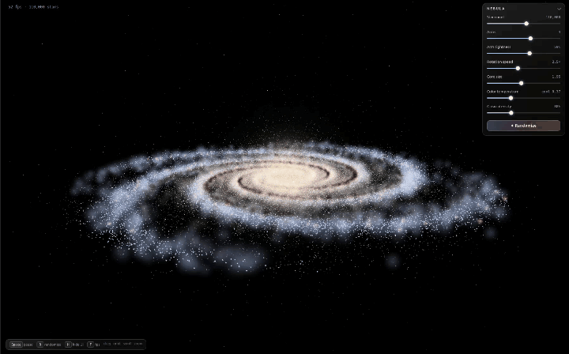

# NEBULA

A generative galaxy simulator that runs in the browser. It draws tens of thousands of stars in spiral arms that rotate, glow, and twinkle, and each seed gives you a different galaxy.



## Features

- **Spiral galaxies.** 110,000 stars by default (up to 200,000) laid out in logarithmic spiral arms, with a central bulge, a field of disk stars, and a faint halo.
- **Differential rotation.** Inner stars orbit faster than outer ones, following a realistic rotation curve. The arms ride a fixed pattern speed so they keep their shape instead of winding up into rings.
- **Realistic look.** Blue young stars and pink star-forming knots line the arms, soft haze glows along them, and dark dust lanes block the light behind them. A warm core sits in the middle. Everything is rendered in HDR and tone-mapped, so the core stays golden instead of turning white.
- **Twinkling starfield** in the background.
- **Supermassive black hole.** Turn it on for a black event horizon, a glowing accretion disk with Doppler beaming, and gravitational lensing that bends the starlight around it. From a low angle the disk arches over the shadow. Two optional extras:
  - **Tidal disruptions.** Every so often a star is shredded, and a thin stream of its gas spirals into the disk as the disk briefly brightens.
  - **Black hole gravity** (collision mode). The black hole pulls on nearby stars and swallows any that stray too close, and each capture sets off a flare. Its mass is exaggerated so the effect is visible.
- **Galaxy collisions.** A smaller companion galaxy falls in on a curved orbit. About 40 seconds after you switch it on (at the default 1× collision speed), it swings past and pulls long tidal tails out of both galaxies, then keeps coming back until the two merge. Its pace is set by its own **Collision speed** slider, separate from the galaxy's rotation speed. This runs as restricted N-body physics on the CPU.
- **Cinematic camera.** After a few idle seconds the camera slowly orbits, with a swaying tilt and gentle zoom. Dragging takes over smoothly and spins with inertia.
- **Control panel.** Live sliders for star count, arms, tightness, rotation speed, core size, color temperature, a color filter (off by default; slide it up to tint the whole galaxy any hue) and glow, plus switches for the cinematic camera, black hole and collision mode. Each switch reveals its own settings when you turn it on. One click on **Randomize** gives you a new galaxy, and it never flips the switches.
- **Presets.** The **Preset** dropdown at the top of the panel loads a saved look. Every preset sets every setting, and **Default** returns to the starting galaxy.
- **No dependencies.** Plain JavaScript and WebGL2, with no frameworks, no build step and no npm.

## Running it

ES modules don't load from `file://`, so serve the folder with any static server:

```bash
python3 -m http.server 8000
```

Then open <http://localhost:8000>. It needs a browser with WebGL2, which includes any recent Firefox, Chrome, Edge or Safari.

## Controls

| Input | Action |
| --- | --- |
| Drag | Orbit the camera (with inertia) |
| Mouse wheel | Zoom |
| Double-click | Glide back to the default view |
| `Space` | Pause / resume |
| `R` | Randomize the galaxy |
| `H` | Hide / show all UI |
| `F` | Toggle the FPS counter |
| `C` | Toggle the cinematic camera |

## Tweaking with URL parameters

Every numeric setting in [`js/config.js`](js/config.js) can be set from the URL. Switches take `1` (on) or `0` (off):

```
http://localhost:8000/?seed=42&armCount=5&starCount=150000
http://localhost:8000/?blackHole=1&bhFlares=1&collision=1&bhGravity=1
```

You can also change settings from the browser console:

```js
nebula.config.armCount = 5;
nebula.regenerate();

nebula.flares.trigger(0);   // fire a tidal disruption flare now (black hole + flares on)
```

## Presets

Presets live in [`presets/`](presets) as JSON files that use exactly the same keys as `js/config.js`. The dropdown loads everything listed in `presets/index.json` (or, when that's missing, everything in the folder listing that `python3 -m http.server` shows). The file name becomes the display name, so `neon-whirlpool.json` shows as "Neon Whirlpool".

With [Claude Code](https://claude.com/claude-code), type `/preset <description>` (for example `/preset a calm, icy spiral with a hungry black hole`). The project skill in `.claude/skills/preset/` designs the preset, saves it, adds it to the index and validates it. To check presets by hand:

```bash
python3 .claude/skills/preset/validate.py --all
```

## Tests

The pure math (seeded random numbers, rotation curve, spiral arms, color temperature and the color filter) lives in [`src/math.js`](src/math.js) and has unit tests that use Node's built-in test runner. No dependencies, nothing to install:

```bash
node --test tests/
```

## How it works

- **Generation** (`js/galaxy/generator.js`): each star gets orbital elements (radius, starting angle, height, size, color, brightness) for its population: arm, bulge, field or halo.
- **Motion** normally runs entirely on the GPU. Each star's angle is `θ = θ0 + ω·t`, so the CPU only uploads the time each frame. The rotation curve is `Ω(r) = v0 / √(r² + rc²)`.
- **Rendering** (`js/render/`): background, haze, stars and core glow are drawn additively into a half-float HDR buffer. Dust is drawn last as an absorbing layer, and then a hue-preserving ACES tone map produces the final image.
- **Black hole** (`js/render/blackHole.js`): the accretion disk is a mesh drawn into the HDR buffer. The tone-map pass then applies a thin-lens mapping (`θ → θ − θE²/θ`) around the projected hole, which bends everything behind it, including the disk. Tidal disruption flares are drawn in the disk's shader.
- **Collisions** (`js/galaxy/collision.js`): every star, haze and dust particle becomes a test particle in two moving potentials. The host is a logarithmic halo that matches the rotation curve exactly; the companion is a Plummer sphere. Positions are integrated with leapfrog and streamed to the GPU each frame. With black hole gravity on, a third, compact mass sits at the host's center and removes any particle that crosses its capture radius.
- **Performance:** at the default 110,000 stars, collision mode simulates about 175,000 particles at roughly 5 ms of CPU time per frame. Lower the star count if it stutters.

## Project layout

```
index.html          full-screen canvas and HUD
css/style.css       styles for the HUD and control panel
js/main.js          bootstrap, render loop, pass order
js/config.js        every tunable parameter (ranges, labels, randomize ranges)
js/galaxy/          star generation, rotation curve, collision physics
js/render/          star, background, black hole and compositor layers
js/shaders/         GLSL shaders as JS template strings
js/gl/              WebGL2 context, shader programs, HDR framebuffer
js/camera/          orbit camera with the cinematic auto-orbit
js/ui/panel.js      control panel
js/ui/presets.js    loads presets/ for the Preset dropdown
src/math.js         pure math (random, rotation curve, spiral arms, color)
tests/              unit tests (node --test)
presets/            saved galaxy presets (JSON) and index.json
```

## Roadmap

- Shareable links
- Bloom
