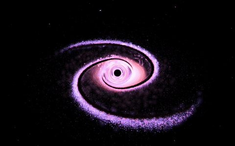
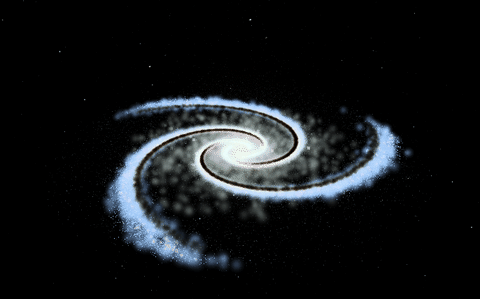

# NEBULA

A generative galaxy simulator that runs in the browser. It draws tens of thousands of stars in spiral arms that rotate, glow, and twinkle, and each seed gives you a different galaxy.


## Features

- **Spiral galaxies.** 110,000 stars by default (up to 200,000) laid out in logarithmic spiral arms, with a central bulge, a field of disk stars, and a faint halo.
- **Differential rotation.** Inner stars orbit faster than outer ones, following a realistic rotation curve. The arms ride a fixed pattern speed so they keep their shape instead of winding up into rings.
- **Realistic look.** Blue young stars and pink star-forming knots line the arms, soft haze glows along them, and dark dust lanes block the light behind them. A warm core sits in the middle. Everything is rendered in HDR and tone-mapped, so the core stays golden instead of turning white, and an over-bright core fades from white-hot at the centre to its own color at the rim. Gas sprites shrink and fade where the gas thins out, so the rim and tidal tails don't break up into separate blobs.
- **Twinkling starfield** in the background.
- **Supermassive black hole.** Turn it on for a black event horizon, a glowing accretion disk with Doppler beaming, and gravitational lensing that bends the starlight around it, with a thin photon ring at the edge of the shadow. From a low angle the disk arches over the shadow. Two optional extras:
  - **Tidal disruptions.** Every so often a star is shredded, and a thin stream of its gas spirals into the disk as the disk briefly brightens.
  - **Black hole gravity** (collision mode). The black hole pulls on nearby stars and swallows any that stray too close, and each capture sets off a flare. Its mass is exaggerated so the effect is visible.
- **Galaxy collisions.** A smaller companion galaxy falls in on a curved orbit. About 40 seconds after you switch it on (at the default 1× collision speed), it swings past and pulls long tidal tails out of both galaxies, then keeps coming back until the two merge. Its pace is set by its own **Collision speed** slider, separate from the galaxy's rotation speed. This runs as restricted N-body physics on the CPU.
- **Framing.** The camera fits each galaxy to its size and centres it in the space beside the control panel, gliding back to the middle when the panel is collapsed or hidden.
- **Cinematic camera.** After a few idle seconds the camera slowly orbits, with a swaying tilt and gentle zoom. Dragging takes over smoothly and spins with inertia.
- **Control panel.** Live sliders for star count, arms, tightness, rotation speed, core size, color temperature, a color filter (off by default; slide it up to tint the galaxy any hue while the sky behind it keeps its natural color) and glow, plus switches for the cinematic camera, black hole and collision mode. Each switch reveals its own settings when you turn it on. One click on **Randomize** gives you a new galaxy, and it never flips the switches.
- **Presets.** The **Preset** dropdown at the top of the panel loads a saved look. Every preset sets every setting, and **Default** returns to the starting galaxy. The dropdown shows a preset's name whenever the current settings match it, including Default on first load.
- **Live wallpapers.** The **Wallpaper** button records a seamlessly looping video (up to 4K) of the galaxy on screen for Wallpaper Engine. See [Live wallpapers](#live-wallpapers-wallpaper-engine).
- **No dependencies.** Plain JavaScript and WebGL2, with no frameworks, no build step and no npm.

## Running it

ES modules don't load from `file://`, so serve the folder with any static server:

```bash
python3 -m http.server 8000
```

Then open <http://localhost:8000>. It needs a browser with WebGL2, which includes any recent Firefox, Chrome, Edge or Safari.

## Controls

| Input | Action |
| --- | --- |
| Drag | Orbit the camera (with inertia) |
| Mouse wheel | Zoom |
| Double-click | Glide back to the default view |
| `Space` | Pause / resume |
| `R` | Randomize the galaxy |
| `H` | Hide / show all UI |
| `F` | Toggle the FPS counter |
| `C` | Toggle the cinematic camera |

## Tweaking with URL parameters

Every numeric setting in [`js/config.js`](js/config.js) can be set from the URL. Switches take `1` (on) or `0` (off):

```
http://localhost:8000/?seed=42&armCount=5&starCount=150000
http://localhost:8000/?blackHole=1&bhFlares=1&collision=1&bhGravity=1
```

You can also change settings from the browser console:

```js
nebula.config.armCount = 5;
nebula.regenerate();

nebula.flares.trigger(0);   // fire a tidal disruption flare now (black hole + flares on)

// Record a wallpaper clip without the dialog (resolves to a video Blob):
const clip = await nebula.recordWallpaper({ width: 1920, height: 1080, fps: 30, seconds: 30, format: 'mp4' });
```

## Presets

<table>
  <tr>
    <td></td>
    <td></td>
  </tr>
  <tr>
    <td align="center"><b>Neon Whirlpool</b></td>
    <td align="center"><b>Glacier Lace</b></td>
  </tr>
</table>

Presets live in [`presets/`](presets) as JSON files that use exactly the same keys as `js/config.js`. The dropdown loads everything listed in `presets/index.json` (or, when that's missing, everything in the folder listing that `python3 -m http.server` shows). The file name becomes the display name, so `neon-whirlpool.json` shows as "Neon Whirlpool". When a name needs characters a file name can't hold, list it in the index as `{"file": "devourers-waltz.json", "name": "Devourer's Waltz"}`.

With [Claude Code](https://claude.com/claude-code), type `/preset <description>` (for example `/preset a calm, icy spiral with a hungry black hole`). The project skill in `.claude/skills/preset/` designs the preset, saves it, adds it to the index and validates it. To check presets by hand:

```bash
python3 .claude/skills/preset/validate.py --all
```

## Live wallpapers (Wallpaper Engine)

The **Wallpaper** button at the bottom of the control panel records the galaxy on screen as a looping video you can use as a live desktop wallpaper with [Wallpaper Engine](https://store.steampowered.com/app/431960/Wallpaper_Engine/) on Steam.

- **Loops seamlessly.** The galaxy's speed is nudged a few percent so its arms turn exactly one arm-spacing per clip, the camera's sway repeats once per clip, and the last few seconds blend into the first. Flares are timed so they never cross the loop point.
- **Smooth at any resolution.** Frames are rendered one at a time and encoded in the browser (WebCodecs), not screen-captured, so a 4K clip comes out just as smooth as a 1080p one. It just takes longer to make.
- **Ready for Wallpaper Engine.** MP4 (H.264) is the default and works for local wallpapers and Steam Workshop uploads. WebM is offered too, for local wallpapers only.

### Make the clip

1. Open NEBULA and set up the look you want: pick a preset or adjust the sliders, then drag and zoom to frame it. The clip starts from exactly what's on screen.
2. Decide on camera motion. With **Cinematic camera** on, the clip gently sways and breathes. Turn it off for a still camera, where only the galaxy itself turns.
3. Click **Wallpaper** at the bottom of the panel and choose:
   - **Resolution:** *Your screen* matches your monitor (up to 4K). Pick 4K if you might use it on a bigger screen later.
   - **Length:** 30 seconds is a good default. Longer clips loop less often but make bigger files.
   - **Frame rate:** 30 fps suits the slow motion. 60 fps is a little smoother and twice the size.
   - **Format:** MP4.
4. Click **Record**. A progress bar shows how far along it is, and **Cancel** stops it. When it finishes, the file (for example `nebula-neon-whirlpool-1440p30-30s.mp4`) lands in your downloads folder.

Recording needs a browser with WebCodecs: a recent Chrome, Edge or Firefox. It takes a few times the clip's length (a 20-second 1080p clip took about 40 seconds on a laptop with integrated graphics), and it's fine to switch tabs while it records. Collision mode can be recorded, but because the encounter plays forward, that clip won't loop seamlessly.

### Set it as your wallpaper

1. Copy the video to your Windows PC if you made it on another computer.
2. Open **Wallpaper Engine** from Steam.
3. Click **Wallpaper Editor** at the bottom left of the Wallpaper Engine window.
4. Click **Create Wallpaper**, select the NEBULA video and click **Open**. The editor imports it as a video wallpaper.
5. Give it a title (the galaxy's preset name works well), then choose **File → Apply Wallpaper** to put it on your desktop.
6. Close the editor. The wallpaper now appears under **Installed** in the main window, where you can pick it for any monitor and adjust playback options.

**If something looks off:**
- *The video won't import or plays black:* use the MP4 version. Wallpaper Engine's help site also covers installing [LAV filters](https://help.wallpaperengine.io/en/videos/lav.html) for codec problems.
- *A small hitch at the loop point:* the clip itself is seamless, but Windows' video playback can pause briefly when an MP4 restarts. A local WebM wallpaper with LAV filters installed usually loops more smoothly.
- *It looks soft:* record at your monitor's native resolution, or at 4K.

## Tests

The pure math (seeded random numbers, rotation curve, spiral arms, color temperature, the color filter and the wallpaper loop timing) lives in [`src/math.js`](src/math.js). It has unit tests that use Node's built-in test runner, and so do the hand-written MP4 and WebM writers in `js/wallpaper/`. No dependencies, nothing to install:

```bash
node --test tests/*.test.js
```

## How it works

- **Generation** (`js/galaxy/generator.js`): each star gets orbital elements (radius, starting angle, height, size, color, brightness) for its population: arm, bulge, field or halo.
- **Motion** normally runs entirely on the GPU. Each star's angle is `θ = θ0 + ω·t`, so the CPU only uploads the time each frame. The rotation curve is `Ω(r) = v0 / √(r² + rc²)`.
- **Rendering** (`js/render/`): background, haze, stars and core glow are drawn additively into a half-float HDR buffer. Dust is drawn last as an absorbing layer, and then a hue-preserving ACES tone map produces the final image. The color filter is applied to the galaxy's own layers, not the tone map, so the background sky isn't tinted.
- **Black hole** (`js/render/blackHole.js`): the accretion disk is a mesh drawn into the HDR buffer. The tone-map pass then applies a thin-lens mapping (`θ → θ − θE²/θ`) around the projected hole, which bends everything behind it, including the disk. Tidal disruption flares are drawn in the disk's shader.
- **Collisions** (`js/galaxy/collision.js`): every star, haze and dust particle becomes a test particle in two moving potentials. The host is a logarithmic halo that matches the rotation curve exactly; the companion is a Plummer sphere. Positions are integrated with leapfrog and streamed to the GPU each frame. With black hole gravity on, a third, compact mass sits at the host's center and removes any particle that crosses its capture radius.
- **Wallpaper recording** (`js/wallpaper/`): each frame is drawn at a fixed time step, captured from the canvas as a `VideoFrame` and encoded with WebCodecs (H.264 or VP9). Small hand-written muxers (`mp4.js`, `webm.js`) package the frames, so there are still no dependencies.
- **Performance:** at the default 110,000 stars, collision mode simulates about 175,000 particles at roughly 5 ms of CPU time per frame. Lower the star count if it stutters.

## Project layout

```
index.html          full-screen canvas and HUD
css/style.css       styles for the HUD and control panel
js/main.js          bootstrap, render loop, pass order
js/config.js        every tunable parameter (ranges, labels, randomize ranges)
js/galaxy/          star generation, rotation curve, collision physics
js/render/          star, background, black hole and compositor layers
js/shaders/         GLSL shaders as JS template strings
js/gl/              WebGL2 context, shader programs, HDR framebuffer
js/camera/          orbit camera with the cinematic auto-orbit
js/ui/panel.js      control panel
js/ui/presets.js    loads presets/ for the Preset dropdown
js/ui/wallpaperDialog.js  the Wallpaper dialog
js/wallpaper/       clip recorder (WebCodecs) and MP4 / WebM writers
src/math.js         pure math (random, rotation curve, spiral arms, color, loops)
tests/              unit tests (node --test)
presets/            saved galaxy presets (JSON) and index.json
```

## Roadmap

- Shareable links
- Bloom
